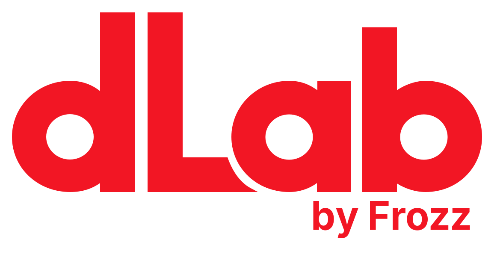

# dLab.Series

Open-Source Audio Tools — **dLab 286** and **dLab 376** for Windows and macOS.

dLab plugins are independent emulations of dbx hardware, based on their operating principles and publicly available information.

[Русский](#русский) · [English](#english) · [Downloads / Скачать](https://github.com/SadFrozz/dLab.Series/releases) · [Changelog](CHANGELOG.md)

## Русский

dLab.Series — два плагина для обработки голоса, инструментов и других аудиозаписей. Каждый объединяет несколько обработок в одном интерфейсе, оформленном по мотивам оригинального устройства.

**dLab 286** — входное усиление, фильтр низких частот, компрессор с ручками Drive и Density, де-эссер, обработка низких и высоких частот LF/HF Detail, экспандер/гейт и выходной уровень. Можно переключаться между режимами Project One и 286S. Подсказки из руководства подсвечивают рекомендуемые диапазоны ручек; настройки при этом вы выбираете сами.

**dLab 376** — окраска звука с вариантами Warm, Bright и Muted, эквалайзер, компрессор с OverEasy и режимами FAST/SLOW, де-эссер и выходной уровень. Warm делает звук теплее, Bright — ярче, Muted — приглушённее. Это тональные варианты обработки, а не модели конкретных марок ламп. Оверсемплинг можно включить отдельно; по умолчанию он выключен.

Оба плагина работают с моно и стерео. В списке эффектов они отображаются отдельно: **dLab 286** и **dLab 376**. Дизеринг и шумоформирование при экспорте оставлены вашей DAW.

### Скачать и установить

Установщики доступны на [странице релизов](https://github.com/SadFrozz/dLab.Series/releases):

| Система | Установщик | Форматы |
|---|---|---|
| Windows 64-bit | `dLab.Series-Windows-x64-Setup.exe` | VST3, VST2 |
| macOS 11 и новее, Intel и Apple Silicon | `dLab.Series-macOS-Universal.pkg` | VST3, AU, VST2 |

1. Закройте DAW, OBS и другие приложения, использующие плагины.
2. Запустите установщик. В Windows выберите форматы и папки для VST3 и VST2. В macOS выберите форматы через **Customize**.
3. Откройте приложение и обновите список плагинов. Для OBS используйте **VST2**: dLab 286 и dLab 376 устанавливаются как два отдельных плагина.

Если раньше вы пользовались бетами Channel286, Channel376, Channel386 или Channel676, Windows-установщик предложит удалить их из выбранной папки VST3. Не оставляйте старые версии 286/376 вместе с новыми: DAW может принять их за один и тот же плагин.

Установщик macOS пока не имеет подписи Developer ID и нотарификации Apple. Universal-сборка содержит версии для Intel и Apple Silicon; локальные проверки выполнялись на Intel Mac.

### Исходники и обратная связь

Хотите собрать плагины самостоятельно? См. [инструкцию сборки](docs/BUILDING.md). JUCE подключён как Git-сабмодуль.

Сообщить об ошибке или предложить улучшение можно в [Issues](https://github.com/SadFrozz/dLab.Series/issues). Для ошибки укажите систему, программу и её версию, формат плагина и шаги, после которых возникает проблема.

### Лицензия

Собственный код проекта опубликован под [MIT](LICENSE). Зависимости имеют отдельные лицензии: JUCE — AGPL-3.0 или коммерческая лицензия, VeSTige — GPL-2.0-or-later, Barlow — OFL-1.1. Готовые плагины также должны распространяться с соблюдением этих условий; подробнее в [NOTICE](NOTICE.md).

Проект не связан с dbx или Harman и не является их официальным продуктом.

## English

dLab.Series includes two plugins for processing vocals, instruments and other recordings. Each combines several processors in an interface inspired by the original hardware.

**dLab 286** includes input gain, a low-cut filter, Drive/Density compression, de-essing, LF/HF Detail enhancement, an expander/gate and output gain. Switch between Project One and 286S modes. Built-in guide choices highlight suggested knob ranges from the manual while leaving your settings unchanged.

**dLab 376** includes Warm, Bright and Muted tonal options, EQ, OverEasy compression with FAST/SLOW modes, de-essing and output gain. The options offer warmer, brighter or darker sound; they do not model specific tube brands. Optional oversampling is off by default.

Both plugins support mono and stereo. Your host lists **dLab 286** and **dLab 376** as separate effects. Use your DAW for final dithering and noise shaping.

### Download and install

Get the installers from [Releases](https://github.com/SadFrozz/dLab.Series/releases):

| System | Installer | Formats |
|---|---|---|
| Windows 64-bit | `dLab.Series-Windows-x64-Setup.exe` | VST3, VST2 |
| macOS 11 or later, Intel and Apple Silicon | `dLab.Series-macOS-Universal.pkg` | VST3, AU, VST2 |

1. Close your DAW, OBS and any other applications using the plugins.
2. Run the installer. On Windows, choose formats and their destination folders. On macOS, choose formats through **Customize**.
3. Reopen your application and rescan plugins. For OBS, choose **VST2**, which installs dLab 286 and dLab 376 as two separate plugins.

The Windows installer offers to remove older Channel286, Channel376, Channel386 and Channel676 beta plugins from your chosen VST3 folder. Avoid keeping old 286/376 versions alongside the new ones: your host may identify them as the same plugin.

The macOS installer currently has no Developer ID signature or Apple notarization. Universal binaries include Intel and Apple Silicon versions; local macOS testing was performed on Intel.

### Source code and feedback

To build the plugins yourself, follow the [build instructions](docs/BUILDING.md). JUCE is included as a Git submodule.

Report bugs or suggest improvements in [Issues](https://github.com/SadFrozz/dLab.Series/issues). For bugs, include your OS, host name and version, plugin format, and steps to reproduce the problem.

### License

Original project code is licensed under [MIT](LICENSE). Dependencies have their own terms: JUCE uses AGPL-3.0 or a commercial license, VeSTige uses GPL-2.0-or-later, and Barlow uses OFL-1.1. Distribution of compiled plugins must also comply with these terms; see [NOTICE](NOTICE.md).

This project is not affiliated with dbx or Harman and is not an official product of either company.
